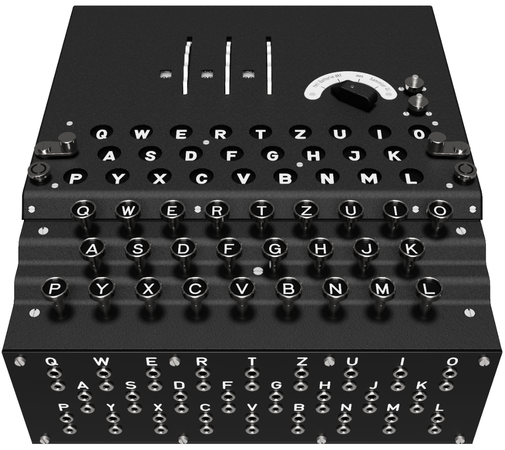

# The Enigma Machine

This repository contains the Enigma Machine blueprints for all of the parts we've made so far on [the Machining Impossible YouTube channel](https://www.youtube.com/@MachiningImpossible).

You're welcome to try making them for yourself if you've got the machinery, but you probably shouldn't.

If you've got any questions, or you'd like to supervise (I'd recommend supervising), head on over to [the Machining Impossible Discord server](https://discord.com/invite/gctq4UJUxw).

 

## Episode 1 - The rotor shaft
- [5004_ROTOR_SHAFT_REV02.pdf](./parts/5004_ROTOR_SHAFT_REV02.pdf)

## Episode 2 - The rotor shaft holder
- [5003_ROTOR_SHAFT_HOLDER_REV02.pdf](./parts/5003_ROTOR_SHAFT_HOLDER_REV02.pdf)

## Episode 3 - Brass
- [5301_ROTOR_CASING_REV03.pdf](./parts/5301_ROTOR_CASING_REV03.pdf)
- [5207_ROTOR_BUSHING_REV03.pdf](./parts/5207_ROTOR_BUSHING_REV03.pdf)
- [5102_ENTRY_WHEEL_BUSHING_REV03.pdf](./parts/5102_ENTRY_WHEEL_BUSHING_REV03.pdf)
- [5605_REFLECTOR_BUSHING_REV03.pdf](./parts/5605_REFLECTOR_BUSHING_REV03.pdf)